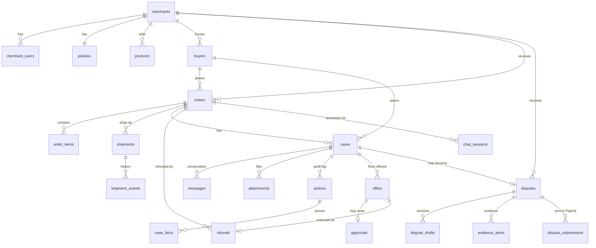

# FirstReply — Database Design

> Database: **PostgreSQL** (Render Postgres) · ORM / migrations: **Drizzle**
> Status: design for review — nothing built yet. Companion to [PLAN.md](../PLAN.md) §7.7 (memory) and §7.8 (trust).

---

## 1. Design rules

1. **Every row belongs to one merchant.** Each table has `merchant_id` directly or through its parent, and every query filters by it. One store can never see another store's data.
2. **Money is stored as integer cents** (`amount_cents bigint`) plus a `currency` code. Never floats.
3. **IDs are UUIDs**; all times are `timestamptz` in UTC.
4. **The audit log is append-only.** `actions` rows are inserted, never updated or deleted (enforced by a database trigger).
5. **Evidence comes from logged facts.** `case_facts` rows always point to the `actions` row (the real PayPal API result) they came from.
6. **Money actions are idempotent.** Each refund has a unique key that is also sent to PayPal as `PayPal-Request-Id`, so a retry can never refund twice.
7. **Secrets are encrypted** in the database (AES-256-GCM, key from an environment variable). Buyer chat tokens are stored only as hashes.
8. **Raw PayPal payloads are kept** (`jsonb`) next to the columns we use, so nothing is lost if we need a field later.

---

## 2. Entity-relationship diagram



Plus three support tables with no business relationships: `webhook_events`, `sync_state`, `llm_calls`.

---

## 3. Tables by area

Legend: **PK** primary key · **FK** foreign key · **U** unique · *M/S/C* = built in Must / Should / Could scope (PLAN.md §12).

### 3.1 Merchants and settings

#### `merchants` *(M)*
| Column | Type | Notes |
|---|---|---|
| id | uuid **PK** | |
| name | text | "Acme Outdoor" |
| slug | text **U** | used in hosted help URL `/s/acme-outdoor` |
| paypal_env | enum `sandbox`/`live` | always `sandbox` for the hackathon |
| paypal_client_id | text | |
| paypal_client_secret_enc | bytea | encrypted |
| paypal_merchant_id | text | PayPal payer ID of the business account |
| soft_descriptor | varchar(22) | statement text, e.g. `ACME FRPLY.CO/HELP` |
| store_notes | text | shipping times, return address, FAQs (memory layer 4) |
| created_at | timestamptz | |

#### `merchant_users` *(M)* — who can log in to the console
| Column | Type | Notes |
|---|---|---|
| id | uuid **PK** | |
| merchant_id | uuid **FK** → merchants | |
| email | citext **U** | case-insensitive |
| password_hash | text | argon2 |
| role | enum `owner`/`staff` | |
| created_at | timestamptz | |

#### `policies` *(M)* — one row per merchant
| Column | Type | Default | Notes |
|---|---|---|---|
| merchant_id | uuid **PK, FK** | | 1-to-1 with merchants |
| auto_refund_limit_cents | bigint | 5000 | $50 |
| trusted_auto_refund_limit_cents | bigint | 10000 | higher limit for 🟢 Trusted |
| reship_allowed | boolean | true | |
| max_reships_per_order | int | 1 | |
| not_received_wait_days | int | 7 | days after ship date before "not received" counts |
| watch_claims_90d | int | 2 | claims in 90 days → 🟡 Watch |
| watch_claim_rate_pct | int | 20 | claim rate → 🟡 Watch |
| high_risk_delivered_claims | int | 2 | "not received" on delivered parcels → 🔴 |
| approval_sla_hours | int | 24 | promised reply time shown to buyers |
| updated_at | timestamptz | | |

### 3.2 Buyers (memory layer 3 + trust system)

#### `buyers` *(M)* — one row per buyer **per merchant**
| Column | Type | Notes |
|---|---|---|
| id | uuid **PK** | |
| merchant_id | uuid **FK** | |
| email | citext | |
| paypal_payer_id | text | from the PayPal order |
| name | text | |
| address_hash | text | SHA-256 of the normalized shipping address — links "different" accounts at the same address without storing it twice |
| trust_tier | enum `trusted`/`normal`/`watch`/`high_risk` | computed by rules |
| tier_reasons | jsonb | e.g. `["3 claims in 60 days", "2 claims on delivered parcels"]` |
| tier_computed_at | timestamptz | |
| manual_tier | enum, nullable | merchant override; wins over `trust_tier` |
| flagged | boolean | merchant flag: never auto-offer money |
| flagged_reason | text | |
| created_at | timestamptz | |

Constraints / indexes: **U**(merchant_id, email) · index(merchant_id, paypal_payer_id) · index(merchant_id, address_hash)

### 3.3 Store, orders, shipping

#### `products` *(M, demo store only)*
id **PK** · merchant_id **FK** · name · description · price_cents · currency · image_url · active

#### `orders` *(M)*
| Column | Type | Notes |
|---|---|---|
| id | uuid **PK** | |
| merchant_id | uuid **FK** | |
| buyer_id | uuid **FK** → buyers | |
| order_number | text | human-friendly, e.g. `FR-10042`; **U**(merchant_id, order_number) |
| paypal_order_id | text **U** | |
| paypal_capture_id | text **U** | needed for refunds |
| source | enum `demo_store`/`paypal_sync` | where we learned about it |
| status | enum `created`/`captured`/`partially_refunded`/`refunded`/`cancelled` | |
| currency | char(3) | |
| amount_cents | bigint | |
| refunded_cents | bigint, default 0 | **CHECK** refunded_cents ≤ amount_cents |
| shipping_address | jsonb | |
| soft_descriptor | varchar(22) | what was actually sent to PayPal |
| raw | jsonb | latest PayPal order payload |
| created_at, captured_at | timestamptz | |

#### `order_items` *(M)*
id **PK** · order_id **FK** · product_id **FK** nullable · name · sku · quantity · unit_price_cents · image_url

#### `shipments` *(M)*
| Column | Type | Notes |
|---|---|---|
| id | uuid **PK** | |
| order_id | uuid **FK** | |
| carrier | text | |
| tracking_number | text | |
| paypal_tracker_id | text | |
| status | enum `shipped`/`on_hold`/`delivered`/`cancelled`/`lost` | mirrors the PayPal tracker |
| is_reship | boolean | |
| replaces_shipment_id | uuid **FK** → shipments, nullable | for reships |
| shipped_at, delivered_at, last_status_at | timestamptz | |

#### `shipment_events` *(S)* — status history ("since last time" + evidence)
id **PK** · shipment_id **FK** · status · note · source enum `paypal`/`demo_panel`/`carrier` · occurred_at

### 3.4 Buyer conversations (memory layers 1–2)

#### `chat_sessions` *(M)* — one per "door" visit
| Column | Type | Notes |
|---|---|---|
| id | uuid **PK** | |
| order_id | uuid **FK** | the only order this session can see |
| case_id | uuid **FK**, nullable | set once the buyer describes a problem |
| door | enum `widget`/`email_link`/`statement`/`hosted_page`/`dispute_inquiry` | for the impact dashboard |
| token_hash | text **U** | the session token is never stored in plain text |
| verified_by | enum `order_number_email`/`signed_link` | |
| ip_hash | text | rate limiting |
| created_at, last_active_at, expires_at | timestamptz | |

#### `cases` *(M)* — one buyer problem
| Column | Type | Notes |
|---|---|---|
| id | uuid **PK** | |
| merchant_id | uuid **FK** | |
| order_id | uuid **FK** | |
| buyer_id | uuid **FK** | |
| issue_type | enum `not_received`/`not_as_described`/`damaged`/`unrecognized_charge`/`cancel`/`other` | from intake classification |
| status | enum `open`/`awaiting_buyer`/`awaiting_merchant`/`resolved`/`escalated`/`disputed`/`closed` | |
| resolution_type | enum `full_refund`/`partial_refund`/`reship`/`explained`/`denied`/`none`, nullable | |
| resolution_amount_cents | bigint, nullable | |
| trust_tier_at_open | enum | snapshot — the tier that applied when the case was decided |
| summary | text | **written by code** from facts and offers, not by the LLM |
| last_seen_snapshot | jsonb | order + tracking state the buyer last saw → "since last time" |
| opened_at, resolved_at, disputed_at | timestamptz | |

Constraint: **one active case per order** — partial unique index on (order_id) where status not in (`resolved`, `closed`).

#### `messages` *(M)*
| Column | Type | Notes |
|---|---|---|
| id | uuid **PK** | |
| case_id | uuid **FK** | |
| seq | int | **U**(case_id, seq) — exact order for replay |
| role | enum `buyer`/`agent`/`merchant`/`tool`/`system` | |
| message_json | jsonb | exact AI SDK message (incl. tool calls / results) for faithful replay |
| text_preview | text | plain text for the console and search |
| is_summarized | boolean | true once folded into a summary (chats > ~50 messages) |
| created_at | timestamptz | |

#### `attachments` *(C)*
id **PK** · case_id **FK** · message_id **FK** · kind enum `photo`/`pdf` · storage_path · mime_type · size_bytes · sha256 · delete_after (timestamptz, dispute window) · created_at

### 3.5 Agent actions, facts, offers, money

#### `actions` *(M)* — the audit log, **append-only**
| Column | Type | Notes |
|---|---|---|
| id | uuid **PK** | |
| case_id | uuid **FK**, nullable | null for worker jobs not tied to a case |
| merchant_id | uuid **FK** | |
| actor | enum `agent`/`merchant`/`system`/`worker` | |
| tool | text | `get_shipment_status`, `issue_refund`, … |
| arguments | jsonb | |
| result | jsonb | real API response (trimmed of secrets) |
| status | enum `ok`/`error`/`blocked_by_policy` | |
| policy_decision | enum `allowed`/`needs_approval`/`denied`, nullable | |
| policy_reasons | jsonb | which rules fired |
| agent_reason | text | the agent's stated reason for the call |
| paypal_debug_id | text | for PayPal support |
| created_at | timestamptz | |

Trigger: rejects UPDATE and DELETE on this table.

#### `case_facts` *(M)* — verified facts, each linked to its proof
| Column | Type | Notes |
|---|---|---|
| id | uuid **PK** | |
| case_id | uuid **FK** | |
| fact_type | enum `tracking_status`/`delivery_confirmed`/`refund_issued`/`offer_made`/`offer_declined`/`inconsistency`/`order_details` | |
| value | jsonb | e.g. `{"status":"DELIVERED","at":"2026-11-02T14:03Z"}` |
| source_action_id | uuid **FK** → actions, **NOT NULL** | the proof |
| observed_at | timestamptz | |

#### `offers` *(M)*
| Column | Type | Notes |
|---|---|---|
| id | uuid **PK** | |
| case_id | uuid **FK** | |
| type | enum `full_refund`/`partial_refund`/`reship`/`return_then_refund` | |
| amount_cents | bigint, nullable | |
| policy_decision | enum `allowed`/`needs_approval`/`denied` | |
| status | enum `proposed`/`pending_approval`/`offered`/`accepted`/`declined`/`expired`/`executed`/`rejected_by_merchant` | |
| offered_at, answered_at, executed_at | timestamptz | |
| executed_action_id | uuid **FK** → actions, nullable | |

#### `approvals` *(M)*
id **PK** · offer_id **FK U** · case_id **FK** · requested_reason (text) · status enum `pending`/`approved`/`rejected`/`expired` · decided_by **FK** → merchant_users · decision_note · due_at · decided_at

#### `refunds` *(M)*
| Column | Type | Notes |
|---|---|---|
| id | uuid **PK** | |
| order_id | uuid **FK** | |
| offer_id | uuid **FK**, nullable | null if refunded outside FirstReply (seen via sync) |
| idempotency_key | text **U** | sent as `PayPal-Request-Id` |
| paypal_refund_id | text **U** | |
| amount_cents | bigint | |
| status | enum `pending`/`completed`/`failed` | |
| created_at | timestamptz | |

Refund flow inside **one database transaction**: lock the order row → check `refunded_cents + amount ≤ amount_cents` → insert the refund with its key → call PayPal → update status and `orders.refunded_cents`.

### 3.6 Disputes (memory layer 5)

#### `disputes` *(S)*
| Column | Type | Notes |
|---|---|---|
| id | uuid **PK** | |
| merchant_id | uuid **FK** | |
| paypal_dispute_id | text **U** | e.g. `PP-R-ABC-10193376` |
| order_id | uuid **FK**, nullable | matched by capture / transaction ID |
| case_id | uuid **FK**, nullable | linked FirstReply case, if any |
| buyer_id | uuid **FK**, nullable | |
| reason | enum `merchandise_or_service_not_received`/`merchandise_or_service_not_as_described`/`unauthorised`/`credit_not_processed`/`duplicate_transaction`/`incorrect_amount`/`other` | PayPal's reason codes |
| stage | enum `inquiry`/`chargeback`/`pre_arbitration`/`arbitration` | |
| status | text | PayPal's status, e.g. `WAITING_FOR_SELLER_RESPONSE` |
| amount_cents, currency | | |
| seller_response_due_at | timestamptz | shown as a countdown in the console |
| outcome | enum `won_by_seller`/`won_by_buyer`/`settled`/`cancelled`, nullable | |
| raw | jsonb | latest PayPal payload |
| created_at_paypal, updated_at | timestamptz | |

#### `dispute_drafts` *(S)*
id **PK** · dispute_id **FK** · version int (**U** with dispute_id) · recommendation enum `fight`/`offer`/`accept` · response_text · evidence_plan jsonb · offer_amount_cents · created_by enum `agent`/`merchant` · model (text) · created_at

#### `evidence_items` *(S)*
id **PK** · dispute_id **FK** · evidence_type (PayPal type, e.g. `PROOF_OF_FULFILLMENT`, `PROOF_OF_REFUND`, `OTHER`) · attachment_id **FK** nullable · source_fact_ids uuid[] (→ case_facts) · notes · submitted_at

#### `dispute_submissions` *(S)* — what was actually sent to PayPal
id **PK** · dispute_id **FK** · draft_id **FK** · action enum `provide_evidence`/`make_offer`/`accept_claim`/`send_message` · request jsonb · response jsonb · paypal_debug_id · submitted_by **FK** → merchant_users · submitted_at

### 3.7 Support tables

#### `webhook_events` *(S)* — dedupe + replay
id **PK** · paypal_event_id **U** · event_type · payload jsonb · signature_verified boolean · received_at · processed_at · error

#### `sync_state` *(S)* — polling bookmarks
merchant_id **FK** + kind enum `disputes`/`transactions` (**PK** together) · last_polled_at · cursor (text)

#### `llm_calls` *(M)* — cost tracking + spending cap
id **PK** · merchant_id · case_id nullable · agent enum `resolution`/`dispute`/`intake` · protocol (`openai`/`anthropic`) · model · input_tokens · output_tokens · latency_ms · error · created_at

---

## 4. Key queries

**Trust tier inputs** (run when a case opens and when a case closes; result stored on `buyers`):

```sql
SELECT
  count(*) FILTER (WHERE c.opened_at > now() - interval '90 days')            AS claims_90d,
  count(*)                                                                     AS claims_total,
  (SELECT count(*) FROM orders o WHERE o.buyer_id = $1)                        AS orders_total,
  count(*) FILTER (WHERE c.issue_type = 'not_received'
                     AND EXISTS (SELECT 1 FROM case_facts f
                                 WHERE f.case_id = c.id
                                   AND f.fact_type = 'delivery_confirmed'))     AS not_received_but_delivered,
  (SELECT count(*) FROM disputes d
     WHERE d.buyer_id = $1 AND d.outcome = 'won_by_seller')                    AS disputes_lost_by_buyer,
  coalesce(sum(c.resolution_amount_cents)
     FILTER (WHERE c.resolved_at > now() - interval '12 months'), 0)            AS refunded_12m_cents
FROM cases c
WHERE c.buyer_id = $1;
```

The same buyer under different emails is caught by also matching `paypal_payer_id` or `address_hash` within the merchant.

**Case summary for the prompt** (memory layer 2, built by code): latest `case_facts` per `fact_type` + all `offers` with their status + current `shipments.status`.

**Impact dashboard:**
- disputes prevented = resolved cases with no linked dispute
- money saved ≈ prevented cases' order amounts × 5.13
- average time to resolve = avg(resolved_at − opened_at)
- breakdown by door, issue type and trust tier

---

## 5. Indexes (beyond PKs and uniques)

| Table | Index | For |
|---|---|---|
| orders | (merchant_id, created_at desc) | console lists |
| orders | (buyer_id) | buyer history |
| cases | (merchant_id, status, opened_at desc) | cases grid |
| cases | (buyer_id, opened_at) | trust queries |
| messages | (case_id, seq) | replay (covered by unique) |
| actions | (case_id, created_at) | timeline |
| case_facts | (case_id, fact_type, observed_at desc) | case summary |
| approvals | (status, due_at) | approvals queue + timeout worker |
| disputes | (merchant_id, status, seller_response_due_at) | disputes grid |
| attachments | (delete_after) | cleanup worker |

---

## 6. Data lifetime

| Data | Kept for | Removed by |
|---|---|---|
| Photos, messages | 180 days after the case closes (PayPal's dispute window) | worker, daily |
| Actions, facts, refunds, disputes | Kept (financial record) | — |
| Chat sessions | 30 days after expiry | worker |
| Webhook events | 30 days | worker |
| LLM call logs | 90 days | worker |

---

## 7. Build order

1. **Day 2:** merchants, merchant_users, policies, products, buyers, orders, order_items, shipments
2. **Day 4–5:** chat_sessions, cases, messages, actions (+ trigger), case_facts, offers, approvals, refunds, llm_calls
3. **Day 10–11:** disputes, dispute_drafts, evidence_items, dispute_submissions, webhook_events, sync_state
4. **Day 12:** shipment_events, attachments
5. Seed script: one demo merchant, 6 products, 3 buyers with different histories (Trusted / Normal / Watch) so the trust tiers show up in the demo
