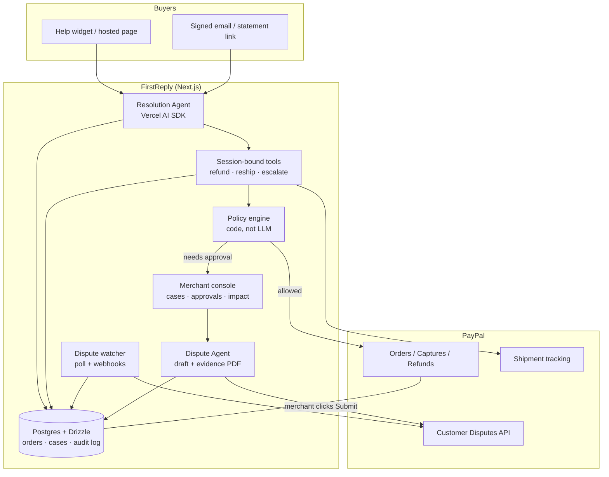

# Architecture

FirstReply is one Next.js app: buyer chat, merchant console, demo store and API routes, plus a small in-process dispute poller. Money never moves because the model said so — the **policy engine** (plain TypeScript) decides.

## Diagram

## Layers

| Layer | Role |
|---|---|
| **Doors** | Widget, hosted `/s/:shop`, signed email links, soft-descriptor statement help — all verify then lock the session to **one order**. |
| **Resolution Agent** | Buyer-facing. Investigates with tools, proposes a fix, never widens scope past the session. |
| **Policy engine** | Deterministic ALLOWED / NEEDS_APPROVAL / DENIED from trust tier, limits, tracking and issue type. Buyer text cannot raise a limit. |
| **Audit log** | Append-only `actions` (+ `case_facts`). Evidence and the console timeline come from here, not from model prose. |
| **Dispute Agent** | Merchant-facing. Reads the case record, drafts fight/offer/accept + PDF. **Submit is always a human click.** |
| **PayPal** | Agent Toolkit for refunds/tracking where it fits; REST for disputes, evidence and offers. |

## Safety invariants

1. Tools close over `merchantId` / `orderId` / `caseId` — the model cannot pass another customer's id.
2. Refunds and reships call the policy engine again at execute time (not only at propose time).
3. Prompt injection is treated as data; scenario eval locks the policy outcomes under adversarial wording.
4. Dispute submit re-checks PayPal's allowed actions immediately before sending.

## Key packages

Next.js 16 · React 19 · Drizzle + Postgres · Vercel AI SDK · `@paypal/agent-toolkit` · pdf-lib · AG Grid · Vitest.
